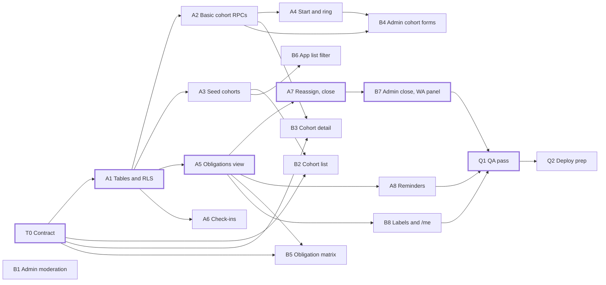

# TesBareng MVP plan: 2 engineers

As of 3 November 2026.

## Summary

Two engineers can finish the MVP in about **15 working days (3 weeks)**, against 19–25 days for one engineer. Engineer A owns the database and server work, and Engineer B owns the web UI. They spend day 1 together writing the cohort contract. After that, B builds screens against the contract while A builds the database, so neither one waits for the other.

- **Engineer A (database and server):** cohort tables, RPCs, the `cohort_obligations` view, check-ins end to end (RPC plus the app detail UI), the reminders, seed data and tests.
- **Engineer B (web UI):** `/cohorts`, `/cohorts/:id`, the obligation matrix, `/admin`, and the cohort changes on `/apps`, `/me` and profiles.
- **What is left** is mostly the cohort system (ADR-007), which has no code yet. Everything else in the MVP is built, except admin moderation and part of the reminders.
- **Already decided:** Day 21 hard close (PRD §17 Q6), one app per member per cohort (Q7), no cap on pure testers (Q12), hosting on Vercel (ADR-003).

## Ownership

Each file group has one owner, so the two engineers rarely edit the same file. The other engineer still reviews every PR in that group.

| Area | Owner | Files |
| --- | --- | --- |
| Schema, RLS, RPCs, views | A | `supabase/migrations/*` (new files only) |
| Database tests | A | `tests/*` |
| Seed data | A | `scripts/seed.ts` |
| Reminders | A | `supabase/functions/send-reminders`, `supabase/snippets/setup_cron.sql` |
| Check-in client code and UI | A | new `web/src/lib/checkins.ts`, check-in section of `web/src/pages/AppDetail.tsx` |
| Cohort client code | B | new `web/src/lib/cohorts.ts` |
| Routes and new pages | B | `web/src/main.tsx`, new `web/src/pages/Cohort*.tsx`, `Admin.tsx` |
| Existing pages | B | `AppList.tsx`, `Me.tsx`, `Profile.tsx`, rest of `AppDetail.tsx` |
| Shared types | B (A asks first) | `web/src/lib/types.ts`, `web/src/lib/data.ts` |
| Contract | Both, A merges | `docs/contract.md` |

Put new cohort and check-in client code in the two new files, not in `data.ts`, to keep conflicts there small. All UI work, including A's check-in section, goes through the `human-centered-design` and `design-qa-review` agents (CLAUDE.md).

## Waves

Inside each wave, the A tasks and the B tasks run at the same time. **Waits for** names the task that must merge before this one can finish. B can start earlier against the contract and fixtures, then connect to real data when that task lands.

Status values: Not started / In progress / In review / Done.

### Wave 0: day 1, together

| ID | Task | Owner | Days | Waits for | Status |
| --- | --- | --- | --- | --- | --- |
| T0 | Cohort contract in `docs/contract.md`: tables, `cohort_obligations` columns, RPC names, arguments and error codes, check-in window rules | A + B | 1 | — | In review |

### Wave 1: days 2–5 (A and B in parallel)

| ID | Task | Owner | Days | Waits for | Status |
| --- | --- | --- | --- | --- | --- |
| A1 | Migration: `cohorts`, `cohort_members`, `assignments`, `check_ins`, `cohort_links`, RLS, write revokes, permission tests | A | 2 | T0 | In review |
| A2 | RPCs: `create_cohort`, `add_cohort_member` (one app per member per cohort, not Owing), `remove_cohort_member`, `leave_cohort`, `set_cohort_link`, `get_cohort_link`, `settle_member`, with tests | A | 1.5 | A1 | In review |
| A3 | Seed: one Forming and one Active cohort with assignments and check-ins | A | 0.5 | A1 | In review |
| B1 | `/admin` shell and moderation: restore apps, edit tester entries (RPCs already exist) | B | 1.5 | — | Not started |
| B2 | `/cohorts` list: Forming, Active, Closed | B | 1 | T0 (real data: A3) | Not started |
| B3 | `/cohorts/:id`: members, schedule and day counter, "Gabung sebagai tester" until Day 7, leave button while Forming, WhatsApp button with the phone-number notice (FR-51) | B | 1.5 | T0 (real data: A2) | Not started |

### Wave 2: days 6–10 (A and B in parallel)

| ID | Task | Owner | Days | Waits for | Status |
| --- | --- | --- | --- | --- | --- |
| A5 | `cohort_obligations` view: fulfilled, Behind, milestones due (own offset for late pure testers, FR-33b), with tests. **Build first in this wave.** | A | 2 | A1 | In review |
| A4 | `start_cohort` (full mesh at N = 13–16, ring k = 14 above) and `join_cohort_as_tester` (lowest coverage first, Day 7 cut-off), with tests | A | 2 | A2 | In review |
| A6 | Check-ins end to end: `check_in` RPC with window rules (PRD §6.10) and the check-in section on app detail | A | 1.5 | A1 | In review |
| B4 | Admin cohort forms: create, add and remove members, start (warn at 13 apps with no pure testers), settle, WhatsApp link, pinned-message template (FR-52) | B | 2 | A2 (start: A4) | Not started |
| B5 | Obligation matrix: sticky first column, glyph plus text in every cell, greyed unassigned cells | B | 2.5 | T0 (real data: A5) | Not started |
| B6 | `/apps` cohort filter and "Ditugaskan" label | B | 1 | A3 | Not started |

### Wave 3: days 11–14 (A and B in parallel)

| ID | Task | Owner | Days | Waits for | Status |
| --- | --- | --- | --- | --- | --- |
| A7 | `reassign_slot` and `close_cohort` (Day 21 hard close; only milestones due before close count), with tests | A | 1.5 | A5 | In review |
| A8 | Reminders: cohort-day kinds (Day 1, 2, 5, 7, 13) and check-ins due in `due_reminders()`, `setup_cron.sql`, tests for `due_reminders()` | A | 2 | A5 | In review |
| B7 | Admin: reassign and close screens, WhatsApp reminder panel (FR-48), archive reminder (FR-53) | B | 1.5 | A7 | Not started |
| B8 | "Belum tes" label on app cards, cohort obligations and to-do order on `/me` (FR-28), cohort history on profiles (FR-55) | B | 2 | A5 | Not started |

### Wave 4: day 15, together

| ID | Task | Owner | Days | Waits for | Status |
| --- | --- | --- | --- | --- | --- |
| Q1 | Run one cohort end to end on seed data; screenshots at 375, 768 and 1280 px; `design-qa-review` with no Critical findings left | A + B | 1 | all | Not started |
| Q2 | Deploy prep with the owner: hosted Supabase project, secrets, cron job, absolute `og:image` URLs | A + owner | 0.5 | Q1 | Not started |

Totals: each engineer has 13 days of their own tasks over days 2–14, plus 2.5 shared days. Wave 2 is half a day over for both, and wave 3 has half a day spare to absorb it.

## Critical path and hand-offs

The end date depends on **T0 → A1 → A5 → A7 → B7 → Q1**. A slip in any of these moves the end date.

Hand-offs from A to B:

- **A2 → B3, B4:** cohort detail and the admin forms switch from fixtures to real RPCs.
- **A3 → B2, B6:** the cohort list and the app list filter get real seed data.
- **A4 → B4:** the admin's start-cohort button goes live.
- **A5 → B5, B8:** the matrix, "Belum tes" labels and `/me` obligations read the real view.
- **A7 → B7:** the reassign and close screens go live.

## Done and risks

A task is done only when every item below is true:

- [ ] `npm test` passes on the local stack, with a test for every new rule and error code
- [ ] `docs/contract.md` matches both the database and the web code
- [ ] New screens have screenshots at 375, 768 and 1280 px and a `design-qa-review` pass with no Critical findings open
- [ ] Copy is in Indonesian, only masked emails are shown, and status uses glyph plus text, never colour alone

| Risk | Effect | What we do |
| --- | --- | --- |
| `cohort_obligations` (A5) is late or wrong | B5, B8, A7, A8 and B7 all wait on it, so wave 3 slips | Fix its columns in T0. A builds A5 first in wave 2, before A4 and A6 |
| The contract changes mid-way | B's screens break against the new shape | Change both sides in one PR, with tests (CLAUDE.md) |
| Design QA reopens screens | Extra days in wave 4 | Run `design-qa-review` per screen as it lands, not only on day 15 |
| A share image per profile (FR-58) | Vercel serves one static image; per-profile images need extra work | Not in this plan. Decide on an approach before deploy |
| PRD Q8 (other admins) and Q11 (badge names) are open | Small copy and role changes later | Do not block on them; ask the owner before Q2 |
